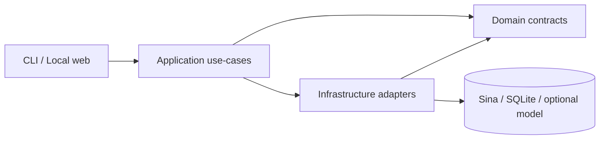

# News24 architecture — V1.1

## Architectural style

A **feature-oriented modular monolith**: one process and an optional single-writer SQLite database, no message broker, no required external search/index service. Logical boundaries provide a clear ownership map without pretending this is a distributed microservice architecture.

`interfaces` are entrypoints and should have no domain decisions; `application` owns business orchestration and stable actions; `domain` holds versioned data contracts and errors; `infrastructure` implements external transport, storage and model integrations.

### Current module map

| Responsibility | Canonical source |
|---|---|
| News/analysis/ingestion types | `src/news24/domain/` |
| Collection orchestration | `src/news24/application/ingestion/` |
| Model evidence service, deterministic hashes and prompts | `src/news24/application/intelligence/` |
| Job worker and schedules | `src/news24/application/jobs/` |
| Report / review / evaluation / health | `src/news24/application/{reporting,review,evaluation,observability}/` |
| Sina requests/strict paging/parser | `src/news24/infrastructure/sina/` |
| SQLite WAL/repository/immutable migrations | `src/news24/infrastructure/sqlite/` |
| OpenAI Responses adapter (opt-in extra) | `src/news24/infrastructure/llm/` |
| CLI and web (static + local HTTP) | `src/news24/interfaces/` |

**Pragmatic dependency:** application orchestration still directly constructs infrastructure adapters in several functions. The enforceable rule is domain purity, no imports from interfaces by inner layers, no direct imports of historical compatibility facades from canonical code, and no canonical module cycles. Injected interfaces are already used for model providers. More granular ports can be introduced later if multiple storage/transport implementations emerge; unnecessary repository abstractions are intentionally avoided now.

### Entrypoint and compatibility

- `news24`, `python -m news24`, and `news24.cli:main` continue to work.
- Previous import paths (for example `news24.core.models.NewsArticle`, `news24.storage.database.SQLiteNewsStore`, `news24.intelligence.service.analyze_article`) are lightweight compatibility forwarders. All new implementation imports must use canonical paths.
- SQL migrations are packaged once under `news24.infrastructure.sqlite.migrations`; Web assets once under `news24.interfaces.web`. Older directly imported migration file paths are replaced by the current package-resource contract.
- Historical `src.*` implementation is frozen in `legacy/src/`. The original top-level script launchers remain thin wrappers for checked-out repository workflows, but historical internals are not shipped with the News24 wheel.

### Data and correctness invariants

1. Each Sina news article is unique by source ID. Content amendments create immutable revisions and source snapshots are saved as data.
2. Ingestion checkpoints only advance with proven pagination coverage in the same SQLite transaction as the news writes; incomplete results remain explicit.
3. News quote spans are lexical evidence, not independent semantic truth or investment recommendation.
4. Human review is append-only, source-version fenced and optimistic; no earlier review is overwritten.
5. At-least-once jobs record attempts and bound retries; source probes do not claim a complete source SLA.
6. Local Web is read-only without a token, localhost-only even when operator mode is enabled, and renders untrusted content using text nodes.

## Quality gates

`tests/architecture` enforces import boundaries, import DAG, compatibility identity and single packaged sources for SQL/JS assets. The original behavioral tests remain in `tests/unit`, `tests/contract`, `tests/integration`, `tests/e2e`, and `tests/legacy`. CI verifies a distributable wheel contains no legacy code and does include all migrations and web assets.

## ADR and operational authority

- Architecture decisions: [ADR-0001 through ADR-0005](../adr/)
- API contract: [workbench-api.md](workbench-api.md)
- Runtime operations: [V1.0 runbook](../runbooks/v1.0.md)
- Live-source/model production gates: [roadmap.md](roadmap.md)

The live Sina API and model output accuracy still require independent tests; no folder refactor changes those limits.
